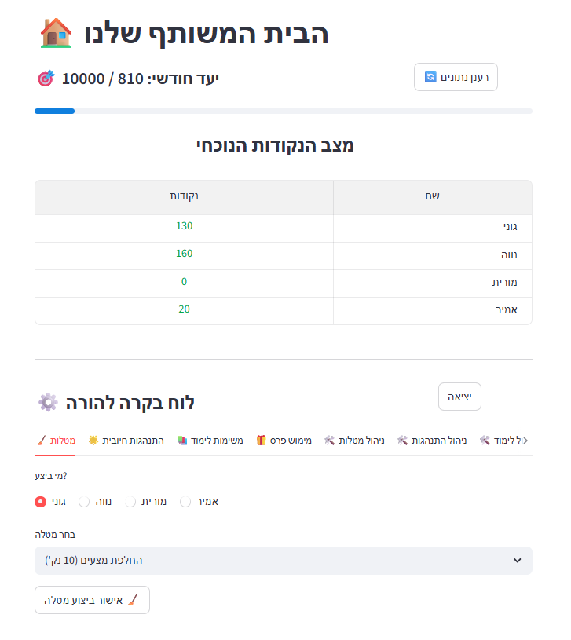

# Family Rewards · הבית שלנו

A Hebrew, right-to-left family app that turns everyday activities into points, lets children choose a reward to work toward, and gives parents control over prizes and point adjustments.

The current product is **Family Rewards 2**, built with React and TypeScript on Cloudflare Workers and D1. Each deployment serves one family and uses its own database.

## Features

- Switch children from the header and see their available points.
- Complete activities across chores, learning and behavior categories. Activities and prizes are sorted by points, low to high.
- Choose a personal reward goal, see the points still needed, and receive encouragement as progress grows.
- Work toward a monthly family goal based on activity in the current Israel calendar month. Prize spending does not reduce that progress.
- See the four most recent actions on the home screen.
- Browse eight days of history, expand to six months, and filter by date or action type. The collapse control remains accessible while browsing.
- Share updates across devices, with refresh after actions and periodic refresh while the app is visible.

## Family access and parent mode

| Family access | Parent mode adds |
| --- | --- |
| Select a child, complete activities, choose a reward goal and browse history | Redeem prizes, cancel individual new actions, correct balances with a reason, manage activities/prizes, edit the monthly target and update family/parent passwords |

Parents can sign in directly if the family password is forgotten. In parent mode, a parent can generate a private, single-use recovery code after confirming the current parent password. The code resets a forgotten parent password and signs out existing sessions; it must be saved privately before it is needed. See the [recovery guide](https://github.com/amir-kedem/family_rewards/blob/family-rewards-v2/v2/PASSWORD_RECOVERY.md).

Both passwords accept four or more characters. Family sessions last seven days and parent sessions 30 minutes. Password updates invalidate affected old sessions. Family data and credentials are not included in the public source.

History is retained for six calendar months, independently of available balances. Imported legacy activity is viewable; parents can correct balances when reliable cancellation links are missing.

## Source and deployment status

| Item | Current status |
| --- | --- |
| New application | [`family-rewards-v2` branch, `v2/`](https://github.com/amir-kedem/family_rewards/tree/family-rewards-v2/v2) |
| Active deployment | Cloudflare Workers Builds deploys commits from `family-rewards-v2` for the current family instance |
| Default branch | `main` still contains the legacy Flet application code; this README introduces the new product |
| New-family setup | Private invitation and parent wizard implemented; maintainer completed an isolated Cloudflare pilot and reported successful functional checks |
| Updates to other family instances | Manual versioned pilot/selected/all workflow implemented with plan mode; activation requires protected credentials and deployment cutover |

## Getting started

Read the [v2 setup guide](https://github.com/amir-kedem/family_rewards/blob/family-rewards-v2/v2/README.md) for local checks, Cloudflare setup, passwords and migration from Google Sheets.

Google Sheets is an optional migration source. The new app stores activity in D1 and calculates monthly progress from its history; an ongoing `MonthlyLedger` sheet is not required.

The [provisioning guide](https://github.com/amir-kedem/family_rewards/blob/family-rewards-v2/v2/PROVISIONING.md) explains private instance configuration, expiring invitations and the parent setup wizard. The [onboarding and release plan](https://github.com/amir-kedem/family_rewards/blob/family-rewards-v2/v2/ONBOARDING_AND_RELEASES.md) tracks remaining work, including guided data migration and additional parent editing tools. The [release guide](https://github.com/amir-kedem/family_rewards/blob/family-rewards-v2/v2/RELEASES.md) explains reviewed versions, pilot-first rollout and the required activation steps.

## Application structure

On the `family-rewards-v2` branch, `v2/src/` contains the interface, `v2/worker/` the API and authentication, `v2/migrations/` the D1 schema, `v2/public/` the initial password helper, and `v2/scripts/` and `v2/tests/` the supporting tools and checks.

<details>
<summary>Legacy Flet setup and deployment</summary>

## Earlier Family Rewards application

A gamified task and reward system designed to drive behavior and accountability in family environments.



[View Project](https://github.com/amir-kedem/family_rewards)

## Platform

The previous application used Flet dynamic web and Google Sheets. These instructions are retained for existing legacy installations. Family Rewards 2 uses the Cloudflare architecture described above.

The legacy application path is:

- `app_flet.py` for the Flet web app.
- `src/point_system/` for shared data cleaning, Google Sheets access, and point-system service logic.
- Google Sheets worksheets for persistent data: `Members`, `Chores`, `Behavior`, `Education`, `Prizes`, `History`, and `MonthlyLedger`.
- `MIGRATION_TODO.md` as the working checklist for continuing the migration and tracking remaining cleanup.

## Run Flet Web

```powershell
.\scripts\run_flet_web.ps1
```

Use a custom port if needed:

```powershell
.\scripts\run_flet_web.ps1 -Port 8001
```

## Change Process

Continue changes from `MIGRATION_TODO.md`:

1. Pick the next unchecked migration item.
2. Move shared behavior into `src/point_system/` when it belongs to the backend/service layer.
3. Keep UI behavior in `app_flet.py`.
4. Run the QA script after each meaningful backend or workflow change:

```powershell
.\venv\Scripts\python.exe scripts\predeploy_check.py
```

For a live Google Sheets workflow check that does not touch the real production tabs, run:

```powershell
.\venv\Scripts\python.exe scripts\predeploy_check.py --live-action-qa
```

That live QA command writes only to isolated QA worksheets: `QA_Members`, `QA_History`, and `QA_MonthlyLedger`.

## Deploy Flet To A Web Server

Use the Flet app as a dynamic web app. Python runs on the server and Google service account secrets stay server-side.

Required environment variables:

```text
POINT_SYSTEM_SPREADSHEET=https://docs.google.com/spreadsheets/d/...
POINT_SYSTEM_SERVICE_ACCOUNT_JSON={"type":"service_account",...}
POINT_SYSTEM_ADMIN_PASSWORD=change-this-password
FLET_FORCE_WEB_SERVER=true
FLET_SERVER_IP=0.0.0.0
FLET_SERVER_PORT=8000
```

Many hosts provide `PORT` instead of `FLET_SERVER_PORT`; `app_flet.py` maps `PORT` automatically when present.

Production start command:

```bash
python app_flet.py
```

Docker deployment:

```bash
docker build -t family-rewards-flet .
docker run --rm -p 8000:8000 \
  -e POINT_SYSTEM_SPREADSHEET="https://docs.google.com/spreadsheets/d/..." \
  -e POINT_SYSTEM_SERVICE_ACCOUNT_JSON='{"type":"service_account",...}' \
  -e POINT_SYSTEM_ADMIN_PASSWORD="change-this-password" \
  family-rewards-flet
```

Before publishing, share the Google Sheet with the service account email as Editor.

</details>
